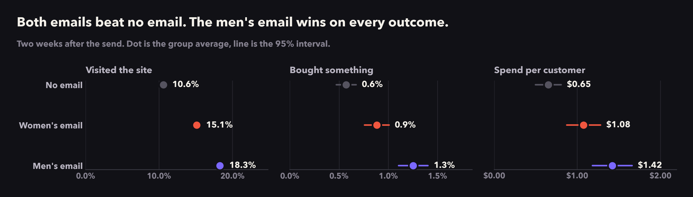

# Experimentation Toolkit

**Decision-first experimentation, worked end to end on real data.**



Most A/B testing tools answer one question: *is the result significant?* A business is asking something else: **what should we do, and what does it cost us if we're wrong?**

This toolkit treats every experiment as a purchase of information and every readout as a decision. Each module answers a question a product or marketing team actually asks, and ends with a recommendation someone can act on.

## How I approach experiments

1. **Decide before you look.** The decision rule, guardrails and the smallest lift worth acting on are written down before any result is seen. The plan is a file the analysis reads, not a slide.
2. **Calibrate every method on the data you have.** Before trusting a test, I run thousands of fake A/A experiments on real control-group data and check that it gets false positives and intervals right. Textbook formulas often break on real metrics like revenue.
3. **Answer in money and risk, not p-values.** Incremental revenue per 1,000 emails, the expected loss of each option, and the chance each option is best.
4. **People respond differently, so decisions should too.** Find who the treatment actually changes, and decide who to treat after counting the cost.
5. **Say what the data can't tell you.** Some questions have no reliable answer at this sample size, and saying so is part of the result.

## Modules

| # | Question | Status |
|---|---|---|
| [01](notebooks/01_explore_hillstrom.ipynb) | Can we trust this test? | Done |
| [02](notebooks/02_decide_before_looking.ipynb) | What do we decide before looking? | Done |
| 03 | Do our methods actually work on this data? (A/A calibration) | Next |
| 04 | How many customers do we need? (power by simulation) | Planned |
| 05 | What happens if we peek every day? | Planned |
| 06 | Did the email work, and by how much? | Planned |
| 07 | Which email should we send, in dollars and risk? | Planned |
| 08 | Who should get the email at all? (uplift and targeting) | Planned |
| 09 | What if we could not randomize? (difference-in-differences, synthetic controls) | Planned |

New modules get added over time. Each one adds reusable code to `exptoolkit/` and its own numbered notebook.

## Data

**Hillstrom email marketing dataset** (MineThatData, 2008). 64,000 customers who bought in the past year were randomly assigned to a men's merchandise email, a women's merchandise email, or no email, and tracked for two weeks: site visits, purchases and spend.

The data is not stored in this repo. `scripts/download_data.py` fetches it from the original source.

## Run it

```bash
python3 -m venv .venv
source .venv/bin/activate
pip install -e ".[notebooks]"
python scripts/download_data.py
jupyter notebook notebooks/
```

## Layout

```
exptoolkit/     reusable code: data, decision plans, checks, charts, style
notebooks/      one notebook per module, outputs saved
plans/          decision plans the notebooks read
docs/figures/   charts used in this README
scripts/        data download
```

Every chart uses one shared style (`exptoolkit/style.py`): each group keeps the same colour everywhere, uncertainty is always shown, and titles state the finding.
