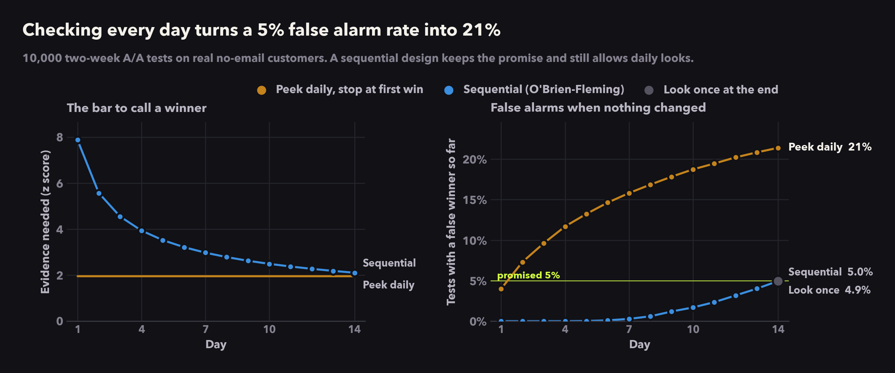

# Experimentation Toolkit

**Is your A/B test telling you the truth?** Decision-first A/B testing in Python: trust checks, A/A calibration, power by simulation, safe peeking, and decisions in dollars, worked end to end on a real 64,000-customer email test, plus causal inference when you can't randomize.

[](https://github.com/ai-with-md/experimentation-toolkit/actions/workflows/tests.yml)




## What most A/B tests get wrong, measured on real data

| Common practice | What happened on real customers | Notebook |
|---|---|---|
| Check results every day and stop at the first win | **21%** false alarms instead of the promised 5% | [05](notebooks/05_peeking.ipynb) |
| Switch to the bootstrap because revenue is skewed | **9%** false alarms with 1,000 customers per group | [03](notebooks/03_aa_calibration.ipynb) |
| Size the test with the textbook formula | Too optimistic on revenue: 161K per group vs **173K** by simulation | [04](notebooks/04_power_by_simulation.ipynb) |
| Read "not significant" as "no effect" | This test would have missed a worthwhile lift **5 times out of 6** | [04](notebooks/04_power_by_simulation.ipynb) |
| Expect CUPED to shrink the noise | A year of purchase history removed **under 0.1%** of revenue variance | [06](notebooks/06_readout.ipynb) |
| Build an uplift model to target who gets the email | Two uplift models ranked customers **no better than random**, and emailing everyone beat every targeting policy | [08](notebooks/08_uplift.ipynb), [09](notebooks/09_targeting_policy.ipynb) |
| Trust difference-in-differences without checking the trends | A fake 1980 "policy" showed a 12-pack effect, and DiD overstated Prop 99's real impact by **about 40%** | [10](notebooks/10_difference_in_differences.ipynb), [11](notebooks/11_synthetic_control.ipynb) |

Every number comes from simulation on real customer data, not from a formula's assumptions.

## How I approach experiments

Most A/B testing tools answer one question: *is the result significant?* A business is asking something else: **what should we do, and what does it cost us if we're wrong?** This toolkit treats every experiment as a purchase of information and every readout as a decision.

1. **Decide before you look.** The decision rule, guardrails and the smallest lift worth acting on are written down before any result is seen. The plan is a file the analysis reads, not a slide.
2. **Calibrate every method on the data you have.** Before trusting a test, I run thousands of fake A/A experiments on real control-group data and check that it gets false positives and intervals right. Textbook formulas often break on real metrics like revenue.
3. **Answer in money and risk, not p-values.** Incremental revenue per 1,000 emails, the expected loss of each option, and the chance each option is best.
4. **People respond differently, so decisions should too.** Find who the treatment actually changes, and decide who to treat after counting the cost.
5. **Say what the data can't tell you.** Some questions have no reliable answer at this sample size, and saying so is part of the result.

## Use it on your own tests

```bash
pip install git+https://github.com/ai-with-md/experimentation-toolkit
```

```python
from exptoolkit.checks import sample_ratio_check
from exptoolkit.estimators import welch_t
from exptoolkit.calibration import aa_test
from exptoolkit.power import simulate_power
from exptoolkit.sequential import obf_boundaries

# df: one row per customer, with an "arm" column and your metric
control = df.loc[df["arm"] == "control", "revenue"]

# 1. Were the groups split the way you planned?
sample_ratio_check(df)["p_value"]

# 2. Does the t-test behave on *your* metric at *your* size? (A/A test on real data)
aa_test(control, welch_t, n_per_arm=5_000).false_positive_rate

# 3. How likely is a test of this size to catch a 10 cent lift?
simulate_power(control, revenue_lift=0.10, n_per_arm=20_000)

# 4. Checking daily for two weeks? Use these thresholds instead of 1.96.
obf_boundaries(n_looks=14)
```

## Modules

| # | Question | Status |
|---|---|---|
| [01](notebooks/01_explore_hillstrom.ipynb) | Can we trust this test? | Done |
| [02](notebooks/02_decide_before_looking.ipynb) | What do we decide before looking? | Done |
| [03](notebooks/03_aa_calibration.ipynb) | Do our methods actually work on this data? (A/A calibration) | Done |
| [04](notebooks/04_power_by_simulation.ipynb) | How many customers do we need? (power by simulation) | Done |
| [05](notebooks/05_peeking.ipynb) | What happens if we peek every day? (sequential testing) | Done |
| [06](notebooks/06_readout.ipynb) | Did the email work, and by how much? (CUPED, multiple comparisons) | Done |
| [07](notebooks/07_decision.ipynb) | Which email should we send, in dollars and risk? ([decision memo](reports/decision_memo.md)) | Done |
| [08](notebooks/08_uplift.ipynb) | Who does the email actually change? (uplift models, Qini curves) | Done |
| [09](notebooks/09_targeting_policy.ipynb) | Who should get the email at all? (targeting policy in dollars) | Done |
| [10](notebooks/10_difference_in_differences.ipynb) | What if we could not randomize? (difference-in-differences, event study) | Done |
| [11](notebooks/11_synthetic_control.ipynb) | A better comparison: synthetic control with placebo tests | Done |

New modules get added over time. Each one adds reusable code to `exptoolkit/` and its own numbered notebook.

## Data

**Hillstrom email marketing dataset** (MineThatData, 2008). 64,000 customers who bought in the past year were randomly assigned to a men's merchandise email, a women's merchandise email, or no email, and tracked for two weeks: site visits, purchases and spend. Used in notebooks 01 to 09.

**Cigarette sales by US state, 1970 to 2000** (Abadie, Diamond and Hainmueller, 2010). Packs sold per person in California and 38 other states, used to measure the effect of California's Proposition 99 in notebooks 10 and 11.

Neither dataset is stored in this repo. `scripts/download_data.py` fetches both from their public sources.

## Run the notebooks

```bash
git clone https://github.com/ai-with-md/experimentation-toolkit
cd experimentation-toolkit
python3 -m venv .venv
source .venv/bin/activate
pip install -e ".[notebooks,dev]"
python scripts/download_data.py
jupyter notebook notebooks/
```

Run the tests with `pytest`.

## Layout

```
exptoolkit/     reusable code: data, decision plans, checks, power, sequential tests, readout, decisions, uplift, causal, charts
notebooks/      one notebook per module, outputs saved
plans/          decision plans the notebooks read
tests/          unit tests, run on every push
reports/        decision memos written by the notebooks
docs/figures/   charts used in this README
scripts/        data download
```

Every chart uses one shared style (`exptoolkit/style.py`): each group keeps the same colour everywhere, uncertainty is always shown, and titles state the finding.

## Contributing

Ideas for new modules, other public datasets, or a method that fails an A/A test on your data are all welcome. Open an issue or a pull request.
